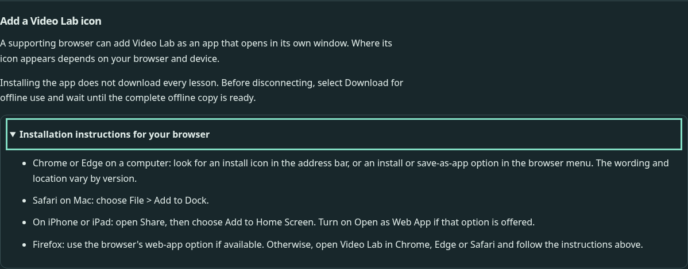
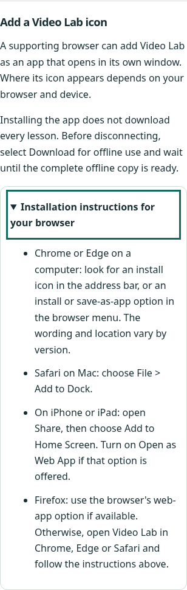
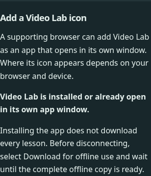

# Independent learner review — app installation and icon

Copyright © 2026 Christopher Snow.

Reviewed 18 October 2026 by the existing independent learner reviewer (gpt-6.1-sol, high reasoning effort, per parent-recorded settings). I did not author this feature. I read `docs/notes/install-plan.md`, began with the actual built page at `http://127.0.0.1:4173/video-lab/`, then inspected its manifest/icons, implementation and test fixture to exercise the prompt lifecycle. No author review report or sceptic report was read. Scope is installation, the new icon and their relationship to offline access; this is not a repeat media-course review.

## Assessment and assumed knowledge

The disclosure's new title, “Offline access and app installation”, makes both actions discoverable. “Add a Video Lab icon” explains that supporting browsers can open the app in a separate window and that icon placement depends on the browser/device. The text does not promise a desktop shortcut in every environment.

The offline boundary is explicit: “Installing the app does not download every lesson. Before disconnecting, select Download for offline use and wait until the complete offline copy is ready.” Accepting a controlled installation prompt left offline readiness false. After a separate complete offline download, the manifest and all three manifest icons were still available with networking disabled.

Reasonable assumed knowledge: a browser menu/address bar, an app window, Share on Apple devices, and a device icon/Dock/home screen. No prior knowledge of PWA manifests, service workers or installation events is needed. A missing Android path in the fallback instructions is noted below.

## F1 — Medium: the browser resolves the app identity outside the intended base path

**Location/quote:** Built `/video-lab/manifest.webmanifest` supplies `"id": "./"`. The plan requires app identity, start URL and scope within `/video-lab/`.

**Effect:** The app is eligible for installation, but its identity is the origin root rather than this course's path. A browser uses the identity to distinguish installed apps and updates. This could identify another app using the same root identity on the shared GitHub Pages origin as the same app. No actual collision or OS installation was induced in this review.

**Evidence:** On the real production preview, Chromium `Page.getAppManifest` returned these parsed values:

```text
id:       http://127.0.0.1:4173/
startUrl: http://127.0.0.1:4173/video-lab/
scope:    http://127.0.0.1:4173/video-lab/
```

Both manifest errors and `Page.getInstallabilityErrors` were empty; eligibility therefore does not detect this identity requirement. The [MDN id reference](https://developer.mozilla.org/en-US/docs/Web/Progressive_web_apps/Manifest/Reference/id), fetched during this review, states: “If id is a relative URL, it is resolved using the origin of start_url.” That matches the observed browser result.

**Direction:** Ensure the identity actually resolves within the intended course path and verify the browser's parsed identity separately from general installability. Preserve a stable identity across releases.

## P1 — Low: Android users lack a manual installation route when no prompt is offered

**Location/quotes:** “Installation instructions for your browser” contains “Chrome or Edge on a computer”, “Safari on Mac”, “On iPhone or iPad”, and a Firefox fallback. The new help contains no Android instruction.

**Effect:** An Android learner who does not receive the optional install button has no explicitly applicable instruction for adding a home-screen icon. The computer instruction is deliberately platform-specific, and the Apple Share path does not apply. The fallback is particularly useful because a supporting browser may not offer a prompt immediately.

**Evidence:** The complete help was expanded at phone and desktop widths. The initial app-specific install button was absent in the fresh contexts. The actual Chromium eligibility check reported no errors after offline saving, but no real `beforeinstallprompt` event occurred during the subsequent two-second observation. I do not infer from this Linux headless observation that an Android browser will never offer a prompt; the issue is the missing documented route when it does not. The plan explicitly includes a home-screen icon and manual instructions when prompting is unsupported or not offered.

**Direction:** Add an applicable Android browser-menu/home-screen route with the same qualification about browser/version wording. Keep the computer and Apple routes clearly scoped.

## Behaviour and appearance checked

| Browser | Viewport | Themes | Coverage |
| --- | --- | --- | --- |
| Headless Chromium 156.0.8078.4 | 1440 × 1000 | light, dark | Actual page, expanded help, keyboard disclosure/button activation, controlled prompt states, simulated existing app window |
| Headless Chromium 156.0.8078.4 | 390 × 844, touch-enabled context | light, dark | Same states and responsive inspection |

The outer disclosure and installation help opened with Enter. A controlled prompt offer exposed “Install Video Lab”; Enter activated it. While its choice remained pending, the button was disabled and the page said “Complete or dismiss the installation prompt in your browser.” Cancellation removed the consumed button and retained the browser-help route. A controlled prompt error displayed actionable fallback guidance. Acceptance said “You accepted the installation request. Check your browser's apps or your device for the Video Lab icon”; it did not claim that an OS app had already been created. A subsequent controlled `appinstalled` event displayed the installed/app-window status and removed installation controls. A separate context simulating an existing standalone app window did not offer installation again.

These are **synthetic lifecycle events**, not actual OS installation. The separate real-browser protocol check established manifest validity and Chromium eligibility only. No real prompt was observed in the short actual-browser observation, and I did not create an app or shortcut on the remote machine.

No uncaught page errors appeared in the four lifecycle sweeps. Document width equalled viewport width in every case. The new controls, expanded prose and focus outlines remained visible in both themes. The static 32-pixel icon and full-size normal/maskable icons were visually inspected: the white play symbol remains recognisable on the orange mark and teal background. The normal and maskable 512 PNGs use the same uncluttered design; their colour meaning does not depend on the page theme. Browser metadata points to the actual local SVG/PNG and Apple touch-icon assets. Actual OS masking, taskbar/Dock presentation and splash-screen appearance were not observed.

The initial built draft incorrectly said Firefox desktop had no built-in installation. The builder independently flagged that statement before this task began and corrected it during the review. Later built-page cases and the retained fallback screenshots show: “Firefox: use the browser's web-app option if available. Otherwise, open Video Lab in Chrome, Edge or Safari and follow the instructions above.” I do not report the superseded blanket statement as an unresolved finding.

| Desktop dark | Phone light |
| --- | --- |
|  |  |



## Evidence and limits

Temporary evidence is under `/workspace/scratch/install-reader-*`: `first.cjs` inspected the initial page, `matrix.cjs`/`.log` exercised the four controlled lifecycle cases, and `eligibility.cjs`/`.log` records the real browser manifest/installability response plus offline manifest/icon availability. The complete CDP response in the eligibility log supplies the parsed identity quoted in F1. The preview was not listening at first; I started the existing `npm run preview -- --port 4173` command without changing app files.

Limits: no actual OS installation/uninstallation or real browser prompt acceptance; no Windows Firefox, Mac Safari, iOS or physical Android device; no screen-reader audit. Existing-app-window detection and prompt outcomes were simulated explicitly. Some immediate event-state log queries caught the previous React status before its render, while subsequent screenshots showed the settled state; these transient test observations are not reported as app defects. I did not rerun the complete quality suite, re-review all offline media behaviour, or verify the public deployed installation metadata. No product source was modified.
