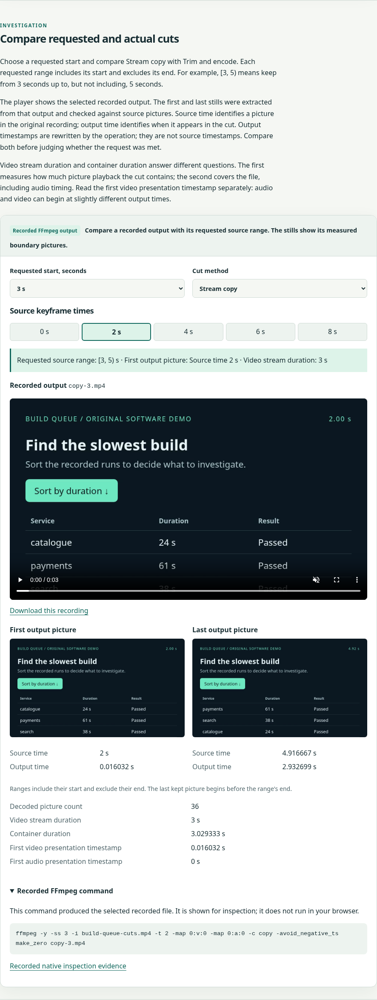
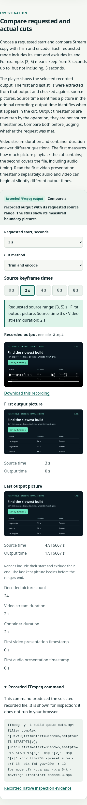
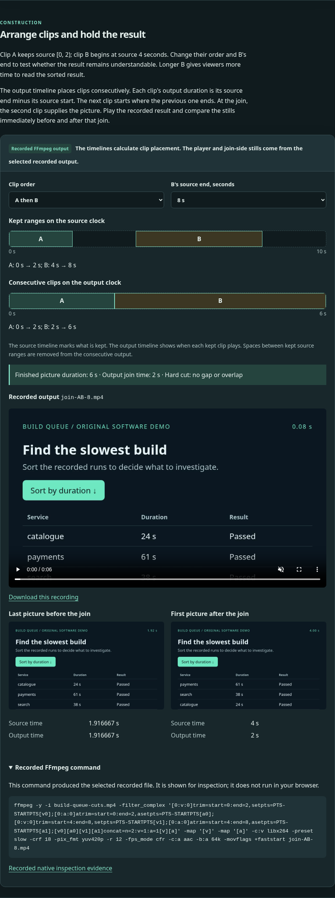
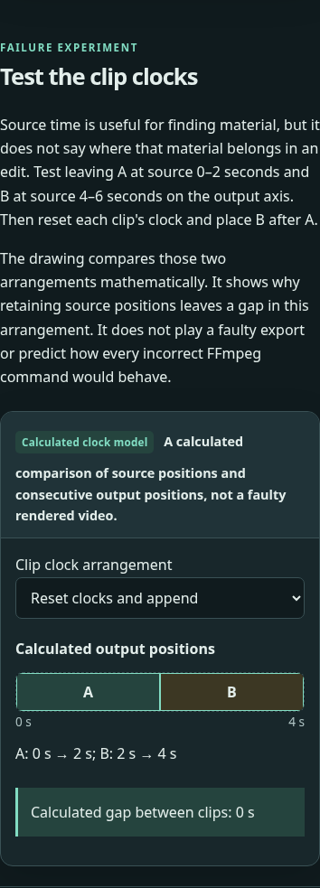

# Independent learner review — Module 2

Copyright © 2026 Christopher Snow.

Reviewed 17 October 2026 by the independent reader from Module 0 (gpt-6.1-sol, high reasoning effort, per parent-recorded settings). I did not author Module 2. I began with the built page at `http://127.0.0.1:4173/video-lab/#/module-2`, read the entire rendered lesson, exercised the controls, and formed the teaching assessment before consulting the Module 2 plan, implementation, media provenance and named references. I did not read the author rationale, fact brief or another review. This is the reader stage, not independent verification of future fixes.

## Assessment and prerequisites

No blocking or medium-severity problem was found. The lesson can be completed using Module 0 and the local material. The copy/encode comparison has real observable consequences, and the separate source/output labels make the changed clock understandable. The distinction between a measured output and a calculated clock model remains visible beside the affected figures. Audio/video start offsets and picture/container durations are reported separately rather than hidden behind a single approximate duration.

Reasonable assumed knowledge: ordinary browser/media controls and files; basic arithmetic and decimals; Module 0's pictures, presentation timestamps, streams, containers, codecs, encoding/decoding and constant frame rate. No Module 1 command grammar or native installation is required: the source section locally introduces FFmpeg, input/output filenames and `-i`. Half-open ranges and source/output time are explained before the learner uses them. Optional recorded commands contain advanced syntax that is not necessary to pass the lesson. “Input seeking” is the one locally unexplained operation name noted below.

Findings are proposals for the sceptic. Low means limited teaching friction; medium would mean a substantial comprehension problem; high would block a core learning action. No challenge reference answer is reproduced here.

## Prose and teaching findings

### P1 — Low: “input seeking” names an unfamiliar operation without explaining it

**Location/quote:** Explanation: “Input seeking with stream copy preserved earlier material for this command.”

**Effect:** A learner can observe the earlier first picture and already knows that some pictures depend on earlier ones. However, the sentence names the command operation responsible without saying what seeking means or connecting it to the position chosen in the input. This matters to the qualification “for this command”: the learner should understand why the observation is command-dependent rather than a universal property of copying.

**Evidence:** The optional command disclosure contains `-ss` before `-i`, but the local command introduction defines only `-i` and the final filename. Neither that disclosure nor the surrounding explanation defines seeking. Module 1, where command behaviour might otherwise be taught, remains planned. The generalisation correctly warns that results differ across commands; this finding does not challenge that factual qualification.

**Direction:** Give the minimum meaning of moving to a chosen position in the input, or connect that operation to the selected recorded command where first named. No full command-language introduction is needed.

### P2 — Low: most graded edit choices transcribe the brief rather than test choosing an edit

**Location/quotes:** Challenge title “Plan a precise edit”. Its brief includes “Use accurately trimmed and re-encoded clips”, prescribes the order of the named clips and both source ranges, and says “Reset each clip's clock to zero”. The form then asks for those same method, order, reset and end choices.

**Effect:** Four of the six checked fields can be answered by transferring explicit instructions into controls. The remaining two require useful duration/output-position arithmetic, so the challenge is not empty. Its successful verdict nevertheless provides limited evidence that a learner can choose an accurate cutting method or plan clip order from an editing goal after experimenting.

**Evidence:** I completed an incorrect attempt, read all progressive hints, completed the reference attempt and edited a completed answer. The grader correctly checks the stated brief; there is no grading bug. This is a limited teaching observation about how much decision-making the assessment calls for, not an assertion that the brief is unsolvable or that its answers should be hidden facts.

**Direction:** Consider giving an editing outcome and constraints that let the learner infer more of the operations from the experiments, or frame the exercise explicitly as calculating and checking an already supplied edit plan. Keep every necessary observation available on the page.

## Factual and interaction findings

No supported factual or interaction defect was found in this review. I checked the displayed result identities, boundary/source times and timeline arithmetic against the fixture/model after reading the page. The primary references listed in `docs/sources.md` support the distinction between trim and timestamp reset and between the concat filter and its similarly named file reader. A technical reviewer should still perform the separate native/source audit; I did not independently regenerate or re-probe all media.

I also deliberately blocked the default copied-output media request. The visible error said, “The browser could not play this recording. Download the file, or inspect the pictures and timing evidence in the cut and join experiments.” Switching to the valid encoded result restored actual playback and removed the alert. A suspected stale-error state was therefore rejected rather than reported as a defect. Negative numeric challenge answers were rejected with field-specific conceptual feedback.

## Exact browser coverage

| Browser | Viewport | Themes | Coverage |
| --- | --- | --- | --- |
| Headless Chromium 156.0.8078.4 | 1440 × 1000 | light, dark | Entire lesson; full control/state sweep |
| Headless Chromium 156.0.8078.4 | 390 × 844, touch-enabled context | light, dark | Entire lesson; same control/state sweep |

In all four cases I exercised:

- Source playback, pause, a changed playback position and mute state; source command disclosure.
- Empty, incorrect and correct predictions; keyboard radio selection.
- All three cut starts × both methods; every selected output played; first/last source and output labels, measurements and each command disclosure were inspected.
- Both join orders × both B-end choices; every recorded result played; source/output timeline positions and the stills on either side of the join were inspected, including reversed order and the longer result hold.
- Both clock arrangements and their changed gap/axis labels; all four time-model disclosures.
- Empty and incorrect challenge attempts, work retained after reload, all five hints, a successful reference attempt, removal of an old verdict after editing, reset cancellation and discard.
- Reflection notes retained after reload and cleared; all ten section links, return-to-explorer, Module 0 prerequisite, overview and browser back/forward; theme toggling.

The four full sweeps reported no uncaught page errors. Document width matched viewport width (1440 or 390), including every expanded cut/join command. Source and all ten selectable outputs loaded and advanced playback. Additional desktop-light checks confirmed native source play/pause with Space and play through the native mouse control. A separate phone-light failure/recovery check and invalid-numeric attempt are described above.

Rendered screenshots were inspected for source, cut, join and clock states in desktop/phone and both themes. Selected retained evidence:

| Desktop | Phone |
| --- | --- |
|  |  |
|  |  |

Additional temporary scripts, logs and screenshots are under `/workspace/scratch/module2-reader-*`. The main sweep is `module2-reader-controls.cjs` with `module2-reader-controls.log`; failed-media/numeric checks are `module2-reader-errors.cjs` and its log; native controls were checked with `module2-reader-native.cjs`. No product source was changed by this reviewer.

Limits: Chromium browser emulation, not a physical phone or screen-reader audit. Most playback validation used the media element API; native keyboard/mouse playback received the separate desktop check above. I did not exercise every native player overflow-menu/fullscreen option, validate downloads or external links, listen to the tone, run Firefox/WebKit, regenerate media, run a fresh native verification or execute the project's quality suite. Touch contexts and responsive layout were covered; an exhaustive tap-only or keyboard-only traversal was not. Source-to-picture agreement here relies on the existing fixture's recorded mapping and displayed stills; the separate technical review must verify it against native output.
