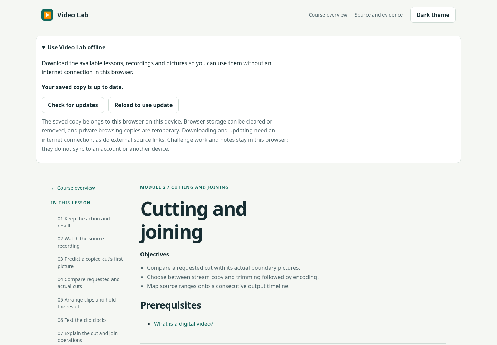
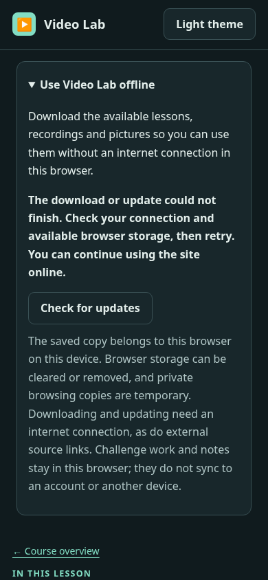
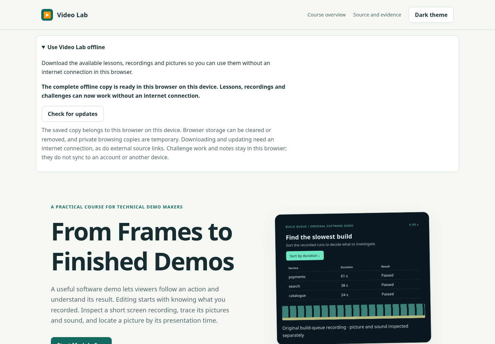
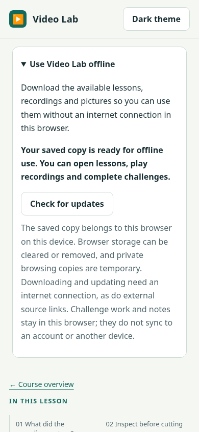
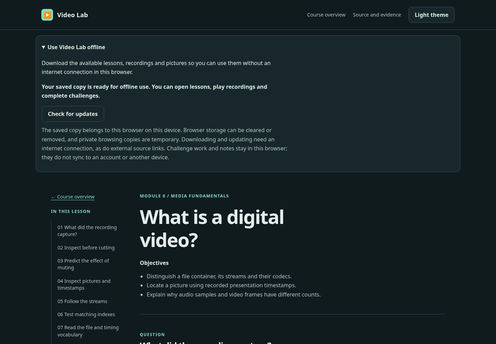

# Independent learner review — offline access

Copyright © 2026 Christopher Snow.

Reviewed 18 October 2026 by the existing independent learner reviewer (gpt-6.1-sol, high reasoning effort, per parent-recorded settings). I did not author offline support. I read `AGENTS.md` and `docs/notes/offline-plan.md`, then inspected the actual production preview at `http://127.0.0.1:4173/video-lab/`. I began with the page and ordinary download/disconnection behaviour before reading the offline test fixture and implementation to exercise failure/update states. No other review report was read.

## Assessment and assumed knowledge

Initial saving, disconnected reloads, new tabs, recording playback/seeking and saved work behaved as advertised. The disclosure explains the browser/device boundary, temporary private browsing storage and external-link limitation without requiring knowledge of service workers or caches. It is usable by the stated technically experienced audience. Browser storage, reloading a tab and reconnecting to the internet are the only additional assumed concepts; the visible text supplies the relevant consequences.

The two findings concern status communication, not observed loss of saved media or work. Medium means uncertainty or contradiction affecting a learner's decision to rely on offline access. No blocking/high-severity failure was found. R1 was raised as a possibility by the builder while this review was underway; I independently reproduced it before the builder's subsequent patch. R2 arose from my failure-state inspection. Findings are proposals for the sceptic, not accepted fixes.

## R1 — Medium: a background update can leave an obsolete “up to date” status

**Location/quote:** Offline disclosure: “Your saved copy is up to date.” At the same time the page offers “Reload to use update”.

**Effect:** The learner receives conflicting guidance about whether a newer copy exists. The usual update-ready explanation also tells them that other open Video Lab tabs will reload. In this stale state that explanation is absent even though the reload action is present.

**Evidence and reproduction:** On a real local HTTP origin serving the built app, download a complete copy, press “Check for updates” with no new release, and observe “up to date”. Then make a changed worker release available and let update detection occur without another panel-button check. I called the browser registration's `update()` method to trigger that detection rather than waiting for the browser's periodic check. When the new complete worker was waiting, the reload button appeared but the status still said “up to date”. Reproduced at desktop light and phone dark. The fixture changes the worker's version identifier while retaining the same app assets; this establishes lifecycle/status behaviour, not compatibility between two different lesson schemas.

**Direction:** Give a waiting complete update precedence over an earlier check result, including the visible explanation of the reload's effect on other tabs.

**Review-time change:** After this reproduction the builder reported patching the stale-notice behaviour and starting new regression checks. The retained screenshot is explicitly **before that fix**. This reader report does not certify the later patch; the independent checker should verify the rebuilt page and relevant connection-change states.

## R2 — Medium: failed update feedback hides that the old offline copy remains usable

**Location/quote:** After a failed update: “The download or update could not finish. Check your connection and available browser storage, then retry. You can continue using the site online.” The only action in that state is “Check for updates”.

**Effect:** This is appropriate advice after a first download fails, but it does not tell a returning learner that the already complete copy survived an unsuccessful update. Someone preparing to disconnect cannot determine the current offline readiness from the visible message. The same generic message appears if a ready offline learner presses “Check for updates” while disconnected; its suggestion of continuing online does not describe what they can presently do.

**Evidence and reproduction:** After a successful initial download, the HTTP fixture served a changed worker but returned 503 for one required image. The page displayed the quoted failure message with no visible retained-readiness statement. The status element still had `data-offline-ready="true"`. I then disconnected, reloaded and played the old Module 2 source recording successfully. Its playback position advanced past the requested seek position. Reloading revealed the normal offline-ready message. Pressing “Check for updates” while still disconnected replaced that reassurance with the generic failure again, while the saved copy remained ready. Reproduced desktop light and phone dark.

This finding does not assert that the failed update corrupts the old copy; the observed behaviour demonstrates that the old copy is preserved correctly.

**Direction:** Distinguish a failed initial save from an unsuccessful update/check when a complete usable copy remains. Keep the current offline-readiness information visible alongside the failed operation and identify the appropriate retry action.

## Coverage and positive evidence

| Browser | Viewport | Themes | Independent coverage |
| --- | --- | --- | --- |
| Headless Chromium 156.0.8078.4 | 1440 × 1000 | light, dark | Production preview: download, status/check, disconnected reload, saved work/notes, all Module 2 recordings, offline new tab |
| Headless Chromium 156.0.8078.4 | 390 × 844, touch-enabled context | light, dark | Same production-preview sweep and responsive inspection |
| Headless Chromium 156.0.8078.4 | 1440 × 1000 light; 390 × 844 dark | As stated | Real HTTP fixture: failed download/retry, deleted cached file/repair, failed update/retained old copy, update waiting/reload, background update status, offline grading and saved completion |
| Headless Chromium 156.0.8078.4 | 1440 × 1000 | light | Persistent browser profile closed/reopened with network disabled; Module 0 notes and native playback survived |

All new panel controls were exercised: disclosure opened with Enter, download activated with Enter, check, retry and reload-to-update; the latter was also activated with Enter. The initial failed download never showed ready, retry produced a complete copy, deletion of one saved picture was detected after reload, and downloading again repaired it. Simulated unsupported service-worker availability displayed “Offline saving is unavailable in this browser. You can continue using Video Lab online” and offered no unsupported saving action.

Across the four production-preview cases, I saved partial Module 0 challenge work and reflection notes online, disconnected and reloaded the lesson, and confirmed both persisted. I then played and sought all six cut variants and four join variants offline. A new offline tab opened Module 2 and played its source recording. No uncaught page errors occurred in these sweeps, and document width equalled viewport width in all four cases. Layout and text remained readable in both themes; no colour-only status meaning or small new control target was observed.

In the HTTP-fixture cases, a successful waiting update preserved the Module 2 reflection note after the reload action. An already open Module 0 tab subsequently reloaded and played offline. Module 2 grading completed offline and the completed state persisted after another offline reload. Browser restart was tested separately with a persistent profile: the named Module 0 lesson, its note and actual native video playback all worked with networking disabled immediately after restart.

The accurate general update-ready text says “Other open Video Lab tabs will reload too; challenge work and notes already saved in this browser will remain.” The observed saved note remained. I did not instrument every tab's automatic navigation event, so this review does not independently certify the reload timing of every open tab.

| Desktop | Phone |
| --- | --- |
|  |  |
|  | Phone dark failure-state evidence appears with R2 above. |

## Evidence and limits

Temporary evidence is under `/workspace/scratch/offline-reader-*`: `normal.cjs`/`.log` contains the four production-preview cases; `states.cjs`/`.log` contains the real HTTP-origin failure/update scenarios; `restart.cjs`/`.log` contains the persistent-profile test. The state script adapts the existing browser test's HTTP fixture; worker requests use a real origin rather than browser route interception. Selected screenshots are retained beside this report.

The first state-script pass used an obsolete Module 2 field label and stopped before grading; the complete rerun used the current visible “Method for the cut comparison” label. One immediate grading log queried the surrounding section rather than the completion element and therefore returned null; the subsequent correct `[data-challenge=edit-plan]` query after offline reload returned true. Neither is reported as a product failure. Some first-download screenshots captured the brief downloading-to-ready transition; retained readiness evidence uses the settled ready/offline states.

Limits: browser emulation, not physical phone or screen-reader testing; no Firefox, WebKit or Safari sweep by this reviewer. Most offline media checks used the native media element's play/seek API, and the persistent-profile case used the lesson's visible Play preview button. I did not exhaust every native player menu/fullscreen action, physically interrupt a network, fill a real browser quota, trigger browser-managed eviction, independently audit every integrity hash/range edge case, test unrelated origins/apps, or verify the public Pages deployment. The existing live site was not changed by this review. I did not rerun the project quality suite; the builder owns that evidence. No app source was modified.
